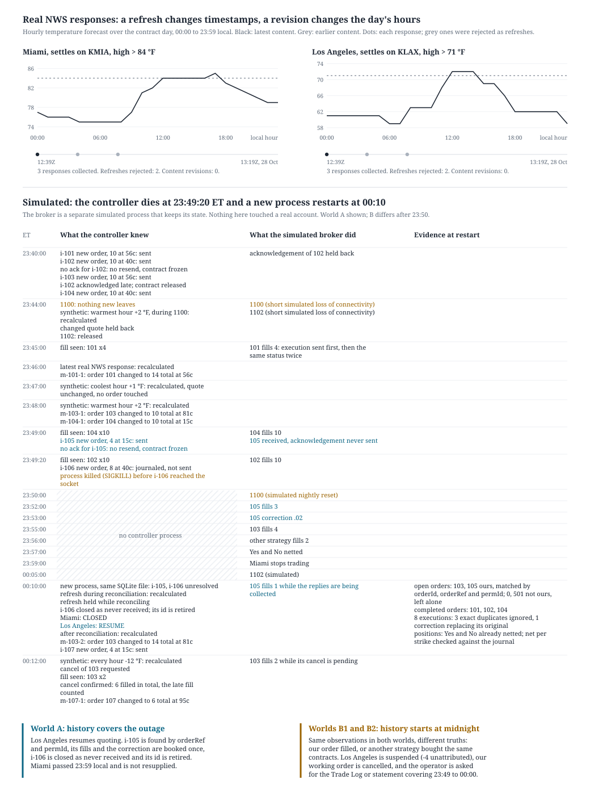

# ForecastEx recovery replay

This repository replays one incident from start to finish and shows what allows quoting to resume after it, and what forbids it.

Two ForecastEx Daily Temperature Forecast Contracts for 28 October 2026 are quoted by one controller process: Miami, which settles on KMIA in Eastern time, and Los Angeles, which settles on KLAX in Pacific time. At 23:49:20 Eastern the controller is killed with SIGKILL. It had just sent a Los Angeles order whose acknowledgement never came back, and it had committed a Miami order to its SQLite journal without writing it to the socket. At 23:50 the simulated gateway loses its connection to IB. A new process starts at 00:10 on the same journal file. By then Miami has stopped trading at 23:59 local time and must not be resupplied; Los Angeles trades until 23:59 Pacific, three hours later.

The new process resends nothing. It requests open orders, completed orders, executions and positions, waits for the end marker of each reply, folds in a fill that lands while it is listening, and only then decides, contract by contract. The broker is a separate simulated process that kept its own state while the controller was dead, so the controller cannot read the answer out of its own memory.

The restart runs in three simulated worlds, unannounced to the controller. In world A the executions reply contains every fill the journal already holds, so absence becomes evidence: the lost order is found by its orderId with a matching orderRef, its fills and one correction are booked once, the Miami order that never left is closed, and Los Angeles resumes. In worlds B1 and B2 those fills are missing from the reply: the history starts later, and no absence proves anything. In B1 our order filled; in B2 it was rejected and another strategy bought the same contracts. The evidence is identical in both. Los Angeles is suspended, and the suspension names the record that would settle it.

Weather inputs are real National Weather Service responses; pricing is an illustrative stand-in; the broker is simulated, and no real account was touched.



The figure is written by the replay command from its own outputs: the top panel from every response in `data/nws/`, the bottom one from the world A journal, the simulated broker's log and the replies recorded at restart. The incident itself reads only `data/incident/`: four of those real responses, frozen and named in `manifest.json` with their SHA-256, which the controller checks before it starts. Adding responses to `data/nws/` changes the figure and nothing else.

## Run it

Python 3.10 or later, standard library only (`sqlite3`, `zoneinfo`, `hashlib`, `socket`, `subprocess`, `unittest`). No account, no key, no network access.

```
python3 -m recovery_replay.replay
python3 -m unittest
```

The first command starts, for each world, a simulated broker process and a controller process, kills the controller at the chosen point, plays the outage, starts a new controller on the same journal, checks the properties below, writes the audit trail and redraws `docs/figure.svg`. It exits non-zero if any property fails. Output on the data in this repository:

```
MIA-20261028-84: ForecastEx, Daily Temperature Forecast Contract (IBKR product: Daily Temperature High) > 84 degF, 2026-10-28, Miami; settles on KMIA (Miami International Airport, 25.79056, -80.31639), America/New_York, last trade 23:59 local; Weather Underground, Daily Observations table, History tab, Daily view; forecast cell MFL/106,51
LAX-20261028-71: ForecastEx, Daily Temperature Forecast Contract (IBKR product: Daily Temperature High) > 71 degF, 2026-10-28, Los Angeles; settles on KLAX (Los Angeles International Airport, 33.93806, -118.38889), America/Los_Angeles, last trade 23:59 local; Weather Underground, Daily Observations table, History tab, Daily view; forecast cell LOX/148,41
terms: https://data.forecastex.com/regulatory/DailyTemperatureTermsandConditions.pdf (modified 2026-08-06, consulted 2026-10-28)

world A  restart decisions: {'MIA-20261028-84': 'CLOSED', 'LAX-20261028-71': 'RESUME'}  observation digest f8e2f84e3972a02c
world B1 restart decisions: {'MIA-20261028-84': 'CLOSED', 'LAX-20261028-71': 'SUSPEND'}  observation digest e05b7aa4abeb12ca
world B2 restart decisions: {'MIA-20261028-84': 'CLOSED', 'LAX-20261028-71': 'SUSPEND'}  observation digest e05b7aa4abeb12ca

  pass  controller process killed (SIGKILL) at the chosen point (i-106 journaled, not sent)
  pass  A: LAX resumes, MIA is past its last trading time
  pass  A: i-105 found by orderId with matching orderRef, permId recorded; no second order for it
  pass  A: i-106 never reached the broker, closed, id never reused
  pass  A: own exposure equals the broker's hidden truth
  pass  B1 and B2: identical observations, identical decision, different truth
  pass  B: the suspension names the missing evidence
  pass  no MIA order after its last trading time; no reqGlobalCancel; no foreign order touched

Audit trail, world A
...
wrote docs/figure.svg, out/audit_A.txt, out/journal_*.sqlite
```

The second command runs the same three worlds through the same code path, then the criteria table below row by row, then 600 deterministic interleavings of the restart callbacks (seeds 0 to 199 for each of A, B1 and B2; one seed in four delivers the live reports after every reply) with the ledger invariants checked after every callback. `python3 -m unittest -v` prints:

```
test_01_intent_committed_then_crash_before_sending (tests.test_criteria.Criteria.test_01_intent_committed_then_crash_before_sending) ... ok
test_02_order_accepted_ack_lost_client_killed (tests.test_criteria.Criteria.test_02_order_accepted_ack_lost_client_killed) ... ok
test_03_partial_fill_while_down (tests.test_criteria.Criteria.test_03_partial_fill_while_down) ... ok
test_04_fill_during_cancel_counted_and_replacement_within_limit (tests.test_criteria.Criteria.test_04_fill_during_cancel_counted_and_replacement_within_limit) ... ok
test_05_duplicate_then_correction (tests.test_criteria.Criteria.test_05_duplicate_then_correction) ... ok
test_06_other_strategy_untouched (tests.test_criteria.Criteria.test_06_other_strategy_untouched) ... ok
test_07_insufficient_history_suspends_with_reason (tests.test_criteria.Criteria.test_07_insufficient_history_suspends_with_reason) ... ok
test_08_equivalent_weather_response_changes_no_order (tests.test_criteria.Criteria.test_08_equivalent_weather_response_changes_no_order) ... ok
test_09_new_input_same_quote_no_order_change (tests.test_criteria.Criteria.test_09_new_input_same_quote_no_order_change) ... ok
test_10_wrong_date_or_stale_output_refused (tests.test_criteria.Criteria.test_10_wrong_date_or_stale_output_refused) ... ok
test_client_id_zero_refused (tests.test_criteria.Criteria.test_client_id_zero_refused) ... ok
test_frozen_inputs_are_checked (tests.test_criteria.Criteria.test_frozen_inputs_are_checked) ... ok
test_history_depth_is_deduced_not_declared (tests.test_criteria.Criteria.test_history_depth_is_deduced_not_declared) ... ok
test_input_for_another_place_is_refused (tests.test_criteria.Criteria.test_input_for_another_place_is_refused) ... ok
test_orderref_or_permid_mismatch_suspends (tests.test_criteria.Criteria.test_orderref_or_permid_mismatch_suspends) ... ok
test_canonical_fahrenheit (tests.test_criteria.Weather.test_canonical_fahrenheit) ... ok
test_local_day_has_its_real_length (tests.test_criteria.Weather.test_local_day_has_its_real_length) ... ok
test_max_temperature_does_not_cover_the_contract_day (tests.test_criteria.Weather.test_max_temperature_does_not_cover_the_contract_day) ... ok
test_synthetic_mutations_are_content_changes (tests.test_criteria.Weather.test_synthetic_mutations_are_content_changes) ... ok
test_world_a_resumes_under_any_interleaving (tests.test_fuzz.Fuzz.test_world_a_resumes_under_any_interleaving) ... ok
test_worlds_b_never_resume (tests.test_fuzz.Fuzz.test_worlds_b_never_resume) ... ok
----------------------------------------------------------------------
Ran 21 tests in 8.233s
OK
```

## What each piece does

| File | Role |
|---|---|
| `recovery_replay/contracts.py` | Contract sheets: venue, product, settlement station and coordinates, date, threshold operator, unit, time zone, settlement source, terms version, forecast grid point. The dated contract is chosen first; the city follows. |
| `recovery_replay/weather.py` | Real NWS responses reduced to relevant content (variable, integer °F, place, every local hour of the contract day, 23 or 25 when clocks change, missing hours), checked separately for freshness and provenance. Labelled synthetic mutations. |
| `recovery_replay/quotes.py` | `QuoteProvider` interface and an illustrative provider. Outputs carry contract, market date, input revision, calculation id, integer cents and quantities, computation time and validity. `admit()` refuses stale, inconsistent or misdirected outputs. |
| `recovery_replay/ledger.py` | SQLite journal (intent committed before sending) and the reconciler: callbacks in any order, orderRef and permId checked against the journal, exact duplicates ignored, corrections replacing, history depth deduced from the executions reply, decision only once every reply has ended. |
| `recovery_replay/controller.py` | The controller process: quoting, journaling, sending, freezing on a missing acknowledgement or on 1100, and the restart procedure. Refuses clientId 0, a weather input from another grid point, and frozen inputs whose hash differs. |
| `recovery_replay/broker.py` | The simulated broker, a separate process: late acknowledgements, duplicate `orderStatus`, `execDetails` before any status, a lost acknowledgement, fills during the outage and during a pending cancel, a correction, delayed Yes/No netting, another strategy's orders, a manual TWS order. Scripted on roles (the n-th order on a contract side), not on order ids. |
| `recovery_replay/replay.py`, `figure.py` | Orchestration, properties, audit trail, figure. |

## Sourced facts

Consulted on 28 October 2026. Where a fact drives code, the code cites it.

ForecastEx, [Daily Temperature Contract Terms and Conditions](https://data.forecastex.com/regulatory/DailyTemperatureTermsandConditions.pdf), file last modified 6 August 2026, SHA-256 `226826cb5d64cddc52c86b99a2e908f25ba48aa431f6c9ffe2c30e55731db511`; Appendix A of the [CFTC 40.2 filing of 6 August 2026](https://www.cftc.gov/filings/ptc/ptc08062614351.pdf) carries the same wording:

- Settlement: "This Contract resolves based solely on the final daily temperature values displayed in the Daily Observations data table" on Weather Underground for the station and date; "No other data, tables, graphs, or displays ... shall be used". Source Agency: Weather Underground.
- "Last Trading Time: 11:59 PM local time on the date listed in the Contract." This is why Miami is closed at 00:10 Eastern while Los Angeles is not.
- Settlement value $1.00 or $0.00; minimum tick $0.01; resolution when the first observation of a later calendar day is published.
- The question template reads "exceed [##]". The sheets use a strict `>`.

IBKR's public ForecastTrader contract list, fetched on 28 October 2026 from `https://www.interactivebrokers.com/tws.proxy/public/forecasttrader/prediction/contract/list?conid=<underlying>&exchange=FORECASTX` (the endpoint its [Prediction Markets](https://www.interactivebrokers.com/predictionmarkets/en/home.php) pages call; response saved in `data/sources/ibkr_forecasttrader_daily_temperature_20261028.json`):

- "Will the highest temperature in Miami (MIA)(KMIA) exceed 84 F on October 28, 2026?", conIds 939505631 (Yes) and 939505635 (No), last trade 03:59 UTC on 29 October, that is 23:59 Eastern.
- "Will the highest temperature in Los Angeles (LA)(LAX)(KLAX) exceed 71 F on October 28, 2026?", conIds 939505324 and 939505330, last trade 06:59 UTC, 23:59 Pacific.
- The same list names KLGA for New York and KBKF for Denver on that date, where the [launch article of 25 November 2025](https://www.interactivebrokers.com/campus/traders-insight/ibkr-climate-energy/daily-high-temperature-markets-at-forecastex/) listed Central Park (KNYC) and Denver International (KDEN). A city is not a contract; the sheet records the station of the dated contract.
- As a complement only, Robinhood's pages for the same contracts name the same stations (excerpts in `data/sources/listings_20261028.txt`).

ForecastEx [Forecast Contract Risk Disclosure](https://www.cftc.gov/sites/default/files/filings/orgrules/25/04/rules04142519330.pdf) (rule filing published on cftc.gov in April 2025; a later version may exist): bids "at prices between $0.02 and $0.99"; "When the combined value of the best Bids for the 'Yes' Position and 'No' Position equal $1.01, the Exchange executes". `admit()` therefore refuses an output whose own Yes and No bids would sum to $1.01 or more.

Stations and grid points: [api.weather.gov/stations/KMIA](https://api.weather.gov/stations/KMIA) and [KLAX](https://api.weather.gov/stations/KLAX) give the station coordinates (saved in `data/sources/`).

Interactive Brokers TWS API documentation:

- [Event contract definition](https://www.interactivebrokers.com/docs/tws-api/doc/ec/contracts): ForecastEx contracts are `OPT` on exchange `FORECASTX`; "Call = Yes and Put = No"; "ForecastEx instruments do not permit Sell orders. Instead, ForecastEx positions are flattened or reduced by buying the opposing contract."
- [Event contract orders](https://www.interactivebrokers.com/docs/tws-api/doc/ec/orders): limit orders only; time in force Day, Good till Canceled or Immediate-Or-Cancel; whole quantities; "IB will net the opposing positions together automatically". Hence exposure is tracked as Yes minus No per strike, a quantity netting does not change.
- [placeOrder](https://www.interactivebrokers.com/docs/tws-api/doc/orders/place-order): "Places or modifies an order"; a new order with an id less than or equal to a previous one is an error. [Modifying orders](https://www.interactivebrokers.com/docs/tws-api/doc/orders/modify-order): same TWS user and same client id; `reqAllOpenOrders` does not bind; binding cancels and resubmits a working order.
- [Next valid id](https://www.interactivebrokers.com/docs/tws-api/doc/next-valid-id): "The order ID sequence persists between sessions."
- [Open orders](https://www.interactivebrokers.com/docs/tws-api/doc/order-management/open-orders): `reqAllOpenOrders` returns open orders once and "does not initiate a subscription", ending with `openOrderEnd`; under client id 0, `reqOpenOrders` binds manual TWS orders.
- [Completed orders](https://www.interactivebrokers.com/docs/tws-api/doc/order-management/completed-orders): orders "for the given day that are no longer modifiable". The end marker `completedOrdersEnd` is an `EWrapper` callback of the official Python client; that page does not show it.
- [Execution details](https://www.interactivebrokers.com/docs/tws-api/doc/order-management/execution-details): by default only executions since midnight; the TWS Trade Log setting can extend this to seven days; "The IB Gateway is limited to only executions from the current trading day since midnight"; `execDetailsEnd`; a correction has an `execId` that "differs from a previous ExecId in only the digits after the final period".
- [Positions](https://www.interactivebrokers.com/docs/tws-api/doc/accounts/positions): per account and contract; `positionEnd` after the initial batch, then updates.
- [Cancelling](https://www.interactivebrokers.com/docs/tws-api/doc/orders/cancel-order): `cancelOrder` only for the same client id; `reqGlobalCancel` "will cancel ALL open orders including those placed directly from TWS". It is never called here.
- [Order status](https://www.interactivebrokers.com/docs/tws-api/doc/order-management/order-status): "Often there are duplicate orderStatus messages"; under PendingCancel "You may still receive an execution while your cancellation request is pending."
- [System message codes](https://www.interactivebrokers.com/docs/tws-api/doc/error/codescodes): 1100 connectivity lost (internet, "a nightly reset of the IB servers, or a competing session"); 1101 restored, market data lost; 1102 restored, market data maintained; during a reset "execution reports and simulated orders will be delayed".

The contracts are addressed by the conIds IBKR publishes. The TWS `symbol` for each city is not written anywhere here: it would come from `reqContractDetails` against a real session, and I have not verified it.

## Criteria

Each row is a test in `tests/test_criteria.py`. Rows 1 to 4, 6, 7, 8 and 9 read the journals and broker logs of the processes the replay command starts; row 5 does too, and also checks a correction that changes the price on the journal directly; row 10 calls `admit()` and the freshness check directly. Further tests cover the deduced history depth, an orderRef mismatch, a forecast from the wrong grid point, a tampered frozen input, clientId 0 and the 23- and 25-hour days.

| Situation | Required observable result | Test |
|---|---|---|
| Intent committed, process killed before sending | The intent is found; no execution is invented | `test_01` |
| Order accepted, acknowledgement lost, client killed | The same order is found; no replacement is submitted | `test_02` |
| Partial fill while the controller is down | Filled and remaining rebuilt from evidence; equals the broker's hidden truth | `test_03` |
| Fill during a cancel | The fill is counted; the replacement respects the authorised quantity | `test_04` |
| Duplicate, then a correction | The duplicate changes nothing; the correction replaces | `test_05` |
| Another strategy's activity | No foreign order cancelled, modified or bound; attribution limits visible | `test_06` |
| History too short | Quoting stays suspended, with reason and missing evidence | `test_07` |
| Equivalent weather response | No order change caused by a download alone | `test_08` |
| New input, same price | The recalculation is traced; no order is touched | `test_09` |
| Wrong date or stale data | The output cannot feed a quote | `test_10` |

## Audit trail

`out/audit_A.txt`, world A. Each order links back to the provider output that produced it: input revision (hash of the weather content), calculation id, then the order and permId, the broker state, the contracts filled.

```
intent   kind   side qty lmt  input rev.   calc_id    orderId permId  broker state   filled
i-101    new    Yes   10  56  8e919427a5fd 7af70e932c     101 7000003 CANCELLED           4
i-102    new    No    10  40  8e919427a5fd 7af70e932c     102 7000004 FILLED             10
i-103    new    Yes   10  56  26c82b97c49b 5e000f2bde     103 7000005 CANCELLED           6
i-104    new    No    10  40  26c82b97c49b 5e000f2bde     104 7000006 FILLED             10
m-101-1  modify Yes   14  56  8e919427a5fd e842e8f13e     101 7000003 ACKED
m-103-1  modify Yes   10  81  94548bc50fed 0a667edb70     103 7000005 ACKED
m-104-1  modify No    10  15  94548bc50fed 0a667edb70     104 7000006 ACKED
i-105    new    No     4  15  94548bc50fed bdbe8b6041     105 7000007 FILLED              4
i-106    new    No     8  40  8e919427a5fd 9556041274     106 -       NEVER_RECEIVED      0
i-107    new    No     4  15  94548bc50fed bdbe8b6041     107 7000008 ACKED               0
m-103-2  modify Yes   14  81  94548bc50fed bdbe8b6041     103 7000005 ACKED
m-107-1  modify No     6  95  d7ae88e02e6d 67e6a91d21     107 7000008 ACKED
own net exposure MIA-20261028-84: -6 (Yes minus No)
own net exposure LAX-20261028-71: -8 (Yes minus No)
```

`i-101` to `i-104` are the first quotes. `m-101-1` tops Miami Yes back up after its fill. `m-103-1` and `m-104-1` reprice after a labelled synthetic revision. `i-105` is the order whose acknowledgement was lost; `i-106` is the one journaled and never sent; both ids stay reserved. `m-103-2` and `i-107` follow the decision to resume. `m-107-1` resizes No to 6 once the cancel of order 103 is confirmed, using an inventory that includes the 2 Yes contracts filled while that cancel was pending: the worst case on the No side is then -8 - 6 = -14, the limit.

## Running it as an operator

- Restart: start the controller on the same journal with a non-zero client id. It freezes every contract, requests the four replies, and holds any quote change until it has decided. It is not told how deep the broker's history goes: executions the journal holds but the reply omits push the proven start later; executions the reply contains pull it earlier.
- State: `sqlite3 out/journal_A.sqlite "select id, kind, state, order_id, perm_id, filled from intent"`; the decision per contract is in `meta` under `decision:<contract>`.
- Incident export: `sqlite3 out/journal_B1.sqlite "select vt, kind, detail from event order by seq"` gives the timeline, and `select v from meta where k='restart_callbacks'` gives every callback received before the decision.
- Conditions to resume a contract: all four replies have ended; every own order's reported fill equals its booked executions; the net position change since the last checkpoint is explained by booked executions; no journaled intent predates the proven start of the history; no orderRef or permId contradicts the journal. Otherwise the contract stays suspended, its own working orders are cancelled, and the decision lists the missing record and what the operator should supply.

## Limits

- Real: the NWS gridpoint responses in `data/nws/` (raw JSON with URL, UTC collection time and HTTP headers, every 20 minutes from 12:39 UTC on 28 October), the station metadata, the contract facts above. Adding later responses to `data/nws/` and rerunning the replay redraws the figure; the incident keeps its frozen inputs.
- Simulated: the broker, the clock, fills, rejections, the netting delay, the connectivity losses at 23:44 and 23:50, the other strategy. The reset times are assumptions: IBKR documents a daily reset without stating its time on the pages above.
- Taken from documentation, not observed: every TWS behaviour listed above. The simulator imitates callbacks as flattened JSON and prices as integer cents; a real adapter converts to `lmtPrice` in dollars at the edge.
- To validate against a real configuration: TWS or Gateway version and Trade Log setting, the time zone of "since midnight" (Eastern in the simulated worlds B), whether the executions reply is one contiguous window (the depth deduction assumes it), whether completed orders survive midnight, whether a rejected order advances `nextValidId`, what a correction changes, how long netting takes, the ForecastEx symbols.
- Weather: the forecast grid cell used is the one the collection resolved, `MFL/106,51` and `LOX/148,41`; the cells that contain the KMIA and KLAX station coordinates are `MFL/105,51` and `LOX/149,41`, one cell away (`data/sources/points_*_station.json`). Settlement uses the station's Weather Underground observations, not any forecast. Hours of the contract day that are already past still carry forecast values in these responses, not observations; a real contract-day high needs the station's observations, which this repository does not use. In the incident, inputs collected earlier on 28 October are used at a simulated clock near midnight, so their age is checked at collection time, not against the scenario clock.
- Pricing: the provider and the limit of 14 contracts are illustrative and say nothing about fair value. Ownership convention: other strategies may trade the same contracts in the same account, so positions check attribution and never establish it.

## Author

Frederic de Lavenne de Choulot, independent engineer. I build and run production automation systems for clients. I have not operated an IBKR or ForecastEx system in production, and this repository has never touched a real account: every order in it goes to the simulated broker.

A 15-minute call: https://cal.theaipipe.com
